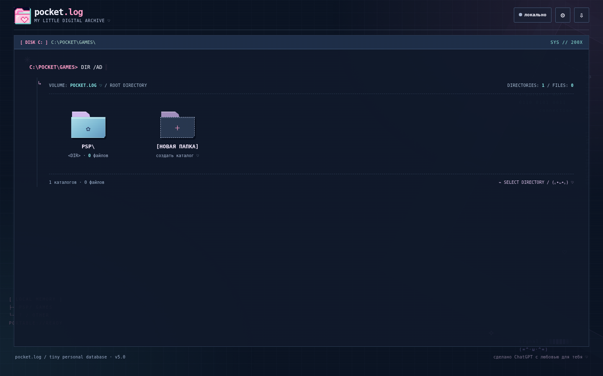

# ♡ Pocket Log 4.0 — мой маленький игровой каталог

> `C:\POCKET\GAMES> DIR /O:N`  ✿  (｡•ᴗ•｡)  
> Личный игровой дневник в духе MS-DOS, карманных консолей и милого японского киберпространства.

**Pocket Log** — бесплатный сайт для своих списков игр: PSP, PS2, Nintendo DS или любой другой консоли. Каждый каталог — папка, каждая игра — запись в ней. Суффикс `.GAME` в списке — только оформление в духе старых файловых менеджеров, не реальный формат игры. Без обложек, жанров и обязательной регистрации в отдельном сервисе. Работает с телефона и компьютера.



## Что умеет

- **Папки консолей:** можно создавать, переименовывать и удалять каталоги; у каталога есть заметка.
- **Игры как файлы:** название, необязательная заметка, две отдельные отметки — **«скачано»** и **«пройдено»**.
- **Сортировка по алфавиту включена по умолчанию** (с числовой сортировкой: `Game 2` перед `Game 10`).
- **Фильтры:** все, не скачаны, скачаны, не пройдены, пройдены. Поиск по названию и заметке.
- **Импорт:** вставить названия строками или выбрать `.txt`, `.csv`, `.json`. Дубликаты **внутри одной консоли** пропускаются (регистр и лишние пробелы не учитываются).
- **Облачная мини-база:** бесплатно хранить один JSON в **своём приватном репозитории GitHub**; записи между устройствами синхронизируются при открытии/возврате на вкладку и после изменений.
- **При потере сети:** уже открытый сайт продолжает сохранять данные в браузере; можно выгрузить резервную копию. Открытие GitHub Pages с нуля без интернета не гарантируется.
- **Напоминания о токене:** за 30, 14 и 7 дней до введённой даты окончания. При ошибке GitHub 401 есть отдельное предупреждение.
- Не требует Node.js, SQL, Firebase, внешних шрифтов или библиотек. Для публикации нужен **один** `index.html`.

## Быстрый старт — если сайт уже опубликован

1. Открой Pocket Log и выбери папку `PSP`.
2. Кнопка **`＋ ИГРА`** — добавить одну запись. Кнопка **`⇧ СПИСОК`** — добавить сразу много игр.
3. В строке игры нажимай **`○ не скачано`** → `✓ скачано` и **`◇ не пройдено`** → `♡ пройдено`.
4. Для заметки или переименования используй **`✎`** справа от строки. Для фильтрации — кнопки над списком.
5. Для другой приставки вернись кнопкой **`CD ..`** и создай **`[НОВАЯ ПАПКА]`**.
6. Посмотри на значок сохранения в правом верхнем углу. **`сохранено ☁`** означает, что синхронизация прошла, **`ошибка sync`** — что изменения остались локально и надо проверить доступ.

**Важно:** отметка **«пройдено»** автоматически означает **«скачано»**; если снять отметку «скачано», статус прохождения тоже сбросится. Случайных дублей по одному названию в одной папке не будет.

## Размещение на GitHub Pages (полностью бесплатно)

### 1. Разместить сам сайт

1. Войди в [GitHub](https://github.com/) и создай **публичный** репозиторий, например `pocket-log` (GitHub → New repository).
2. Загрузи в корень репозитория **`index.html`**. `README.md` тоже можно положить рядом, но для работы сайта он не нужен.
3. В репозитории открой **Settings → Pages**.
4. В разделе **Build and deployment** выбери **Deploy from a branch → main → / (root)** и нажми Save.
5. Сайт откроется по адресу вида `https://USERNAME.github.io/pocket-log/` (USERNAME — твой логин GitHub). Для первой публикации может понадобиться обновить страницу чуть позднее.

### 2. Создать маленькую приватную базу

1. Создай **второй репозиторий**, например `pocket-log-data`, и выбери **Private**.
2. Открой [GitHub → Fine-grained personal access tokens](https://github.com/settings/personal-access-tokens/new).
3. Назначь токену имя и срок действия. В **Repository access** выбери **Only select repositories → `pocket-log-data`**.
4. Для выбранного репозитория укажи **Repository permissions → Contents → Read and write**. Другие разрешения не нужны для работы каталога.
5. Создай токен и скопируй его: после закрытия страницы его полное значение больше не показывается.
6. На сайте нажми **`⚙`**, введи свой GitHub username, имя **приватного** репозитория, скопированный токен и **дату его окончания**, затем **«Подключить ♡»**.
7. Дождись **`сохранено ☁`**. В приватном репозитории появится файл `pocket-log-data.json`.

**На телефоне или другом ноутбуке:** открой тот же адрес GitHub Pages и повтори подключение через `⚙` к **тому же** приватному репозиторию. Тогда список и отметки будут общими. Можно создать для второго устройства отдельный токен с такими же ограниченными правами.

**Секреты:** не помещай токен в `index.html`, `README.md`, скриншоты или общий чат. Никогда не делай репозиторий `pocket-log-data` публичным, если не хочешь, чтобы другие читали личный список. Включение опции **«Запомнить ключ»** хранит его в `localStorage` браузера — только на доверенных устройствах. Без галочки токен хранится в памяти вкладки (`sessionStorage`) до окончания её сессии.

## Импорт списка игр

Открой нужную папку → **`⇧ СПИСОК`**. Форматы:

**TXT** (каждое название на новой строке):

```txt
Persona 3 Portable
The 3rd Birthday
Ghost in the Shell: Stand Alone Complex
Metal Gear Solid: Peace Walker
```

**CSV** (сохраняется из Excel как CSV UTF-8):

```csv
title,note,downloaded,completed
Persona 3 Portable,Русификатор,1,0
The 3rd Birthday,Пройти позже,0,0
```

**JSON** (массив названий или объектов):

```json
[
  "Persona 3 Portable",
  {"title": "The 3rd Birthday", "note": "Любимая атмосфера", "downloaded": true, "completed": false}
]
```

Также принимается **резервная копия Pocket Log**: при её импорте сайт пытается добавить каталоги и игры, которых ещё нет, не удаляя существующие записи. Существующие игры при импорте **не перезаписываются**, поэтому значения статусов старых записей не меняются.

## Как обновлять и сохранять данные

- При обновлении версии просто **замени `index.html`** в том же репозитории GitHub Pages. Структура приватного `pocket-log-data.json` совместима с предыдущими версиями **Pocket Log 2.x и 3.x**.
- Существующие настройки в браузере сохранятся при том же **адресе** сайта; на новом адресе или устройстве синхронизацию нужно настроить отдельно.
- Перед серьёзными изменениями нажми **`⇩`** вверху сайта и сохрани резервную копию `.json` у себя. Это особенно полезно при одновременной работе с разных устройств.
- Синхронизация происходит после изменения (с небольшой задержкой), при открытии страницы, при возврате на вкладку и по нажатию кнопки статуса облака. Для уверенности дождись **`сохранено ☁`** перед закрытием вкладки.

## Токен заканчивается — что делать?

1. В настройках GitHub проверь срок действия токена. Сайт предупреждает за **30, 14 и 7 дней** до **даты, указанной в его настройках**; если браузер позволяет прочитать дату из ответа GitHub, она уточняется автоматически.
2. Создай новый Fine-grained token с доступом **только** к `pocket-log-data` (`Contents: Read and write`).
3. В Pocket Log нажми баннер **`[ ОБНОВИТЬ КЛЮЧ ]`** или **`⚙`** и вставь новый ключ; укажи **новую** дату окончания.
4. Дождись **`сохранено ☁`**, затем отзови старый токен на GitHub. На каждом подключённом устройстве обнови ключ, если он был тем же.

> Напоминания работают **только когда сайт открыт** (или снова открывается/становится активным). Статическая страница не отправляет уведомления, пока полностью закрыта. Без введённой даты сайт не может заранее угадать срок истечения.

## Как поделиться с друзьями ♡

Ты можешь отправить друзьям **ссылку на сайт**, **ссылку на публичный репозиторий** или ZIP с этим `README.md`. Они смогут развернуть **свою копию** сайта на GitHub Pages и создать **свой приватный репозиторий базы**. Тогда у каждого будет отдельный дневник.

- **Не отправляй друзьям свой токен.** Ссылка на публичный сайт **не даёт** доступа к твоему приватному репозиторию.
- На **одном и том же браузере/профиле и адресе сайта** локальное хранилище общее. Если там уже была подключена твоя личная база, переключать сайт на чужой GitHub-репозиторий нежелательно: локальные записи могут объединиться. Для отдельного дневника лучше другу использовать **свой GitHub Pages URL** или другой профиль браузера.
- Для общего дневника нескольких людей понадобятся права на один и тот же приватный репозиторий, но по умолчанию проект рассчитан именно на **личную**, а не многопользовательскую базу.

## Вопросы и неполадки

| Ситуация | Что проверить |
|---|---|
| «локально» вместо «сохранено ☁» | Не подключён токен на этом устройстве; нажми `⚙`. |
| «ошибка sync» | Интернет, наличие приватного репозитория, разрешение `Contents: Read and write` и актуальность токена. После проверки нажми кнопку синхронизации. |
| Ошибка 401 | Токен истёк, отозван или неверен; замени его в настройках. |
| Игры есть на ноутбуке, но нет на телефоне | Подключи телефон к **тому же** приватному репозиторию и обнови синхронизацию. |
| Файл со списком импортирован не полностью | Убедись, что названия непустые, а файлы в UTF-8; уже имеющиеся имена намеренно пропускаются. |
| Хочу полностью офлайн | Просто не настраивай облако; сайт сохраняет данные в браузере. Не забудь периодически экспортировать JSON. |

### Как это устроено

```txt
public GitHub Pages                     private GitHub repository
┌──────────────────────┐                 ┌─────────────────────────┐
│ index.html           │  GitHub API     │ pocket-log-data.json    │
│ интерфейс / фильтры  │ ◄─────────────► │ каталоги / игры / флаги │
└──────────────────────┘                 └─────────────────────────┘
       └── локальный кэш браузера
```

Встроенных трекеров, рекламы, SQL, внешних скриптов и платного сервера нет. При подключённой синхронизации сайт обращается к `api.github.com`; сам GitHub, разумеется, обрабатывает эти запросы в соответствии со своими условиями. Если два устройства одновременно меняют одну запись, применяется механизм объединения по времени изменения: в редких конфликтах более позднее изменение может заменить раннее.

---

<sub>Сделано ChatGPT с любовью для тебя ♡ — *а где-то внизу экрана спрятано ещё одно маленькое сердечко.*</sub>
